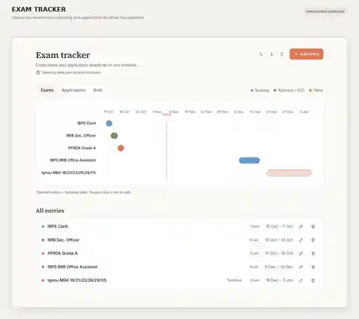

# Exam Tracker

**An offline-first examination planner for competitive examinations, application windows, and important deadlines.**

Exam Tracker brings examination dates and application deadlines together in one visual workspace. Its interactive timeline helps users understand upcoming events, compare application windows, and distinguish confirmed dates from tentative schedules.

The project is designed to be straightforward for non-technical users while remaining easy for developers to run and inspect.

## Application Preview

*The complete application window, showing the interactive examination timeline, category filters, deadline list, and entry controls.*

## Table of Contents

- [Features](#features)
- [Installation and Quick Start](#installation-and-quick-start)
  - [Windows Desktop Setup](#1-windows-desktop-setup-recommended)
  - [Browser Mode](#2-browser-mode-no-installation)
  - [PowerShell Installer](#3-automated-powershell-installer)
- [How It Works](#how-it-works)
- [Developer Guide](#developer-guide)
- [Project Structure](#project-structure)
- [Local REST API](#local-rest-api)
- [Privacy and Data Storage](#privacy-and-data-storage)
- [Contributing](#contributing)
- [Frequently Asked Questions](#frequently-asked-questions)
- [License](#license)

## Features

| Feature | Description |
|---|---|
| Interactive timeline | Visual Gantt-style bars for examination dates, multi-shift schedules, and application windows. |
| Examination tracking | Keep competitive examinations and academic schedules in one place. |
| Application deadline tracking | View application opening and closing dates alongside examination dates. |
| Category filters | Organize entries into Banking, Railways, SSC, Regulatory, and Other categories. |
| Tentative date indicators | Dashed outlines distinguish tentative dates from confirmed schedules. |
| Light and dark themes | Automatic system-theme detection with a manual theme switch. |
| Local data saving | Desktop Mode saves changes to the local data file. |
| Import and export | Back up and transfer schedules using JSON files. |
| Windows desktop launcher | Open the application in a dedicated browser application window. |
| Automatic server fallback | The Windows launcher can use PowerShell when Node.js is unavailable. |
| Offline-first operation | Core application functionality is designed to work without a cloud account or remote application server. |

## Installation and Quick Start

Choose the method that best fits how you want to use Exam Tracker.

### 1. Windows Desktop Setup (Recommended)

This method creates convenient Desktop and Start Menu shortcuts.

1. Open the [Exam Tracker repository](https://github.com/SrujanHrudhay/Exam-Tracker).
2. Select **Code**, then **Download ZIP**. You can also use a packaged download from [Releases](https://github.com/SrujanHrudhay/Exam-Tracker/releases) when one is published.
3. Extract the ZIP file to a folder, such as Documents or Desktop.
4. Open the extracted folder and double-click **Setup.bat**.
5. Follow the setup process. The installer creates shortcuts and launches Exam Tracker.

You can also start the application by double-clicking **Exam Tracker.vbs**.

### 2. Browser Mode (No Installation)

1. Extract the project ZIP file.
2. Open the project folder.
3. Double-click **index.html**.
4. The application opens in your default browser.

Browser Mode stores its data in the browser's local storage. Use the application's Export option to keep a backup of your schedule.

### 3. Automated PowerShell Installer

Windows users can run the installer directly from PowerShell.

~~~powershell
irm https://raw.githubusercontent.com/SrujanHrudhay/Exam-Tracker/main/install.ps1 | iex
~~~

The installer downloads the repository, places the application under:

~~~text
%LOCALAPPDATA%\Programs\ExamTracker
~~~

It then creates Desktop and Start Menu shortcuts and launches the application.

**Security note:** This command downloads and executes a script. Review the contents of [install.ps1](install.ps1) before running it if you want to inspect the installation process.

## How It Works

Exam Tracker uses a lightweight local architecture. On Windows, the desktop launcher selects an available server implementation. On macOS and Linux, the supplied shell launcher uses Node.js. Browser Mode can open the HTML application directly.

### Windows desktop launch flow

~~~mermaid
flowchart TD
    A["Launch Exam Tracker.vbs"] --> B{"Node.js available?"}
    B -->|Yes| C["Start server.js"]
    B -->|No| D["Start server.ps1"]
    C --> E["Local HTTP server"]
    D --> E
    E --> F["Open standalone browser window"]
    F --> G["Exam Tracker interface"]
    G --> H["Local data file"]
    G --> I["Window close notification"]
    I --> J["Graceful server shutdown"]
~~~

### Architecture notes

1. **Silent launch:** The VBScript launcher starts the application without leaving a visible command window.
2. **Two Windows server options:** Node.js runs server.js when available. Otherwise, the launcher can use server.ps1 with the Windows .NET HttpListener implementation.
3. **Local communication:** The desktop interface communicates with the local server through the endpoints documented in [Local REST API](#local-rest-api).
4. **Shutdown handling:** The application notifies the server when its window closes. The server also has an inactivity timeout.

## Developer Guide

The project does not require an npm package installation for its Node.js server. The server uses Node.js built-in modules.

### Windows — Node.js

Open a terminal in the project directory and run either command:

~~~cmd
start.bat
~~~

or:

~~~bash
node server.js
~~~

Then open:

~~~text
http://localhost:3000
~~~

### Windows — PowerShell Server

Node.js is not required for this server option.

~~~powershell
powershell -ExecutionPolicy Bypass -File server.ps1
~~~

### macOS and Linux

The shell launcher requires Node.js. From the project directory, run:

~~~bash
chmod +x start.sh
./start.sh
~~~

If Node.js is not installed, the launcher explains the requirement and attempts to open index.html directly in a browser.

## Project Structure

~~~text
Exam-Tracker/
├── index.html                    # Main interactive application
├── viewer.html                   # Read-only JSON data viewer
├── server.js                     # Local Node.js HTTP server
├── server.ps1                    # Windows PowerShell HTTP server
├── Exam Tracker.vbs              # Silent Windows launcher
├── Setup.bat                     # Windows shortcut and setup helper
├── Create-Desktop-Shortcut.bat   # Desktop shortcut helper
├── start.bat                     # Windows launcher
├── start.sh                      # macOS and Linux launcher
├── start.vbs                     # Additional Windows launcher
├── install.ps1                   # Automated Windows installer
├── push-to-github.bat            # GitHub publishing helper
├── data.json                     # Desktop Mode data file
├── exam-tracker.ico              # Application icon
├── lib/                           # Locally bundled libraries and fonts
├── .github/                       # Issue and pull request templates
├── CONTRIBUTING.md                # Contribution guidelines
├── CHANGELOG.md                   # Project change history
├── LICENSE                        # MIT License
└── README.md                      # Project documentation
~~~

## Local REST API

When the local server is running, its base address is:

~~~text
http://127.0.0.1:3000
~~~

| Method | Endpoint | Purpose |
|---|---|---|
| GET | /api/data | Read records from the local data file. |
| PUT / POST | /api/data | Save updated examination and application records. |
| GET | /api/ping | Notify the server that the application is active. |
| GET | /api/bye | Notify the server that the application window has closed. |

These endpoints are intended for communication between the local application interface and its local server.

## Privacy and Data Storage

- **No account required:** Users can run the application without registering for a cloud account.
- **Local storage:** Desktop Mode uses the local data file; Browser Mode uses browser local storage.
- **No analytics or telemetry:** The project is designed without analytics or telemetry services.
- **Portable backups:** Export examination records to JSON and keep a copy in a safe location.
- **Offline-first:** The core tracking workflow is designed for local use after the project files have been obtained.

Keep exported schedules and local data files private, particularly when they contain personal notes.

## Contributing

Contributions, bug reports, and practical feature suggestions are welcome.

- Read [CONTRIBUTING.md](CONTRIBUTING.md) before submitting code changes.
- Use the repository's **Bug report** issue form to report reproducible problems.
- Use the **Feature request** issue form to suggest improvements.
- Use pull requests for reviewed code and documentation changes.

Please do not include personal schedules, exported user data, credentials, or other private information in issues or pull requests.

## Frequently Asked Questions

<strong>Does Exam Tracker require Node.js?</strong>

Not for every usage mode. Browser Mode opens index.html directly. On Windows, the desktop launcher can use the PowerShell server if Node.js is unavailable. The macOS/Linux shell launcher requires Node.js.

<strong>Why does no Command Prompt window appear?</strong>

The Windows VBScript launcher is designed to start the application silently, avoiding an unnecessary console window during normal desktop use.

<strong>How do I stop the local server?</strong>

Close the Exam Tracker application window. The interface sends a close notification to the local server, which then shuts down.

<strong>How do I move my schedule to another computer?</strong>

Use the application's Export option to create a JSON backup. On the other computer, open Exam Tracker and use Import to restore the schedule.

<strong>Can I use Exam Tracker without an internet connection?</strong>

The core tracking experience is designed for offline use after the application files have been downloaded. Internet access is needed to download the repository or installer.

## License

Exam Tracker is open-source software released under the [MIT License](LICENSE). You may use, modify, and distribute it under the terms of that license.

---

**Developed by [Srujan Hrudhay](https://github.com/SrujanHrudhay).**
